# The Strata Sense Revenue Reset

An 8-deliverable B2B SaaS revenue turnaround, run end to end for an MBA practice capstone: diagnose why growth stalled, build a three-year plan back to it, defend it to a board, build the plan's sales rules into a live HubSpot CRM, and publish everything as an interactive dashboard.

**Live dashboard:** [strata-sense-revenue-reset.streamlit.app](https://strata-sense-revenue-reset.streamlit.app/)

**Strata Sense Technologies is a fictional company.** There was no real instructor or data room for this assignment, so the entire data room (CRM export, account master, finance pack, interviews, competitor and partner files) was built synthetic, calibrated to the brief, with flaws planted blind so the cleaning and diagnosis were genuine tests. No real company, person or result is represented.

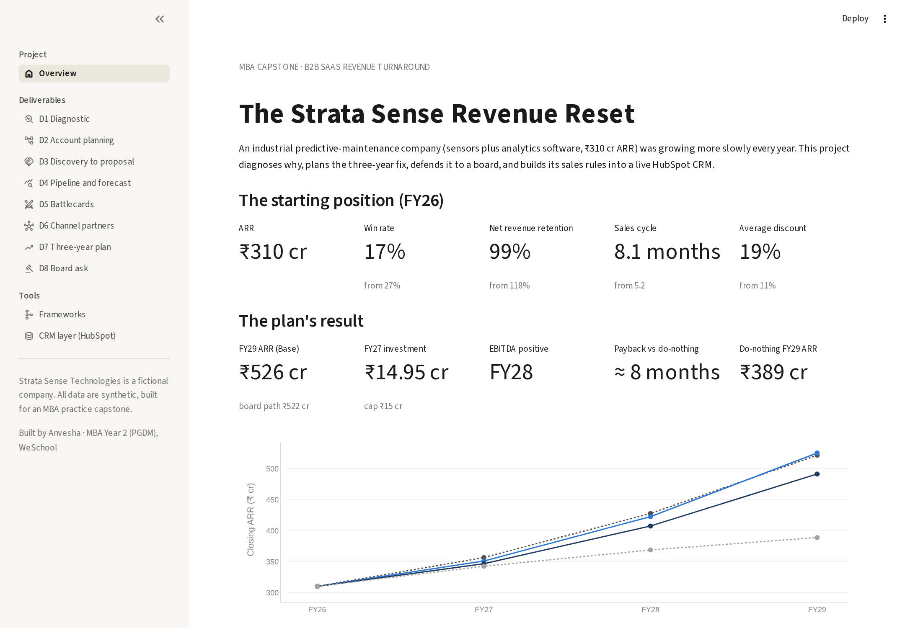

## The problem

Strata Sense, a ₹310 crore ARR industrial predictive-maintenance company (sensors plus analytics software), was growing more slowly every year: win rate fell from 27% to 17% in three years, net revenue retention from 118% to 99%, and forecasts missed by a quarter. The board asked for a plan to grow ARR 15% / 20% / 22% over FY27–29 inside tight financial guardrails.

## What's here

| Folder | Deliverable | Headline |
|---|---|---|
| [`01_diagnostic`](01_diagnostic) | D1 — Diagnostic and hypothesis test | ₹55 cr/yr of root causes ranked; 1 of 6 hypotheses rejected |
| [`02_account_planning`](02_account_planning) | D2 — Account planning and lead generation | 400 / 1,100 / 1,600 account tiers; capacity fits the need, thinly |
| [`03_discovery_proposal`](03_discovery_proposal) | D3 — Discovery to proposal | Live buyer role-play; 13 of 14 hidden facts found; 7.1-month payback |
| [`04_pipeline_forecast`](04_pipeline_forecast) | D4 — Pipeline and forecasting | Hold-out forecast error 23.3%, locked before the outcome was known |
| [`05_battlecards`](05_battlecards) | D5 — Competitive battlecards | Helix is a packaging problem, not a positioning one |
| [`06_channel_strategy`](06_channel_strategy) | D6 — Channel partner expansion | Break-even ₹0.24 cr sourced ARR per partner; 25% share is a coin flip |
| [`07_integrated_model`](07_integrated_model) | D7 — Integrated model and three-year plan | ₹526 cr FY29 ARR plan, ~1,400 formulas, no plugs; 1 disclosed guardrail breach |
| [`08_board`](08_board) | D8 — Board presentation and CEO memo | ₹14.95 cr ask, 6 hires, gated on Q2 FY27 triggers |
| [`dashboard`](dashboard) | Streamlit dashboard | All eight deliverables, the frameworks and the CRM layer on one site |
| [`data`](data) | Shared data-room files | DR1b hold-out snapshot, buyer dossier, competitor dossier, partner file |
| [`docs/screenshots`](docs/screenshots) | Screenshots | Dashboard pages and the HubSpot CRM |

Each deliverable folder has its own `README.md`, its own `code/` (the scripts that produce every number and chart), and its finished output files.

## The plan

Invest ₹14.95 crore in FY27 (inside a ₹15 crore cap): re-tier the sales effort onto the 1,500 of 3,100 accounts that actually convert, sell on proven value with a 15% discount cap, protect Helix-exposed renewals, build a small partner channel in South-East Asia and the Gulf, hire six salespeople from Q3, and gate a reserve on Q2 results. The model takes ARR to ₹351 / ₹423 / ₹526 crore (FY27–29), turns EBITDA positive in FY28, and pays back in about 8 months against doing nothing (₹389 crore by FY29). One guardrail is breached and disclosed rather than hidden: Q1 FY27 CAC payback, which was locked before the plan existed.

## Frameworks used

Each framework is applied to a finding from a deliverable, not added for decoration.

| Framework | Where | What it shows |
|---|---|---|
| Ishikawa (fishbone) root-cause diagram | D1 | Six branches of causes; the largest (₹34 cr/yr) is a product and pricing problem, not a sales one |
| 3-tier account target pyramid | D2 | 400 strategic accounts gave 51% of won ARR on 8.5% of AE time |
| Sales capacity and ramp S-curve | D2 / D7 | New AEs take ~24 months to full productivity, not the 6 assumed |
| B2B buying center on the Buygrid | D3 | IT security, not price, controlled the middle of the purchase |
| Jobs-to-be-Done and the four forces | D3 | Why the offer complements the incumbent instead of replacing it |
| Kotler's five product levels | D5 | The rival gives the basic levels away free, so Strata competes on augmented and potential levels |
| Sales velocity equation | D7 | Velocity roughly doubles FY26 → FY29; win rate is the largest lever |
| Stage-gate capital allocation | D8 | ₹13.03 cr committed now, ₹1.92 cr released only if seven Q2 measures are met |
| Automated CRM pipeline flow | CRM | Stage exit rules become computed flags; flagged deals go to clean-up |

The dashboard's Frameworks page has interactive versions of the velocity, ramp and stage-gate tools.

## The dashboard

[strata-sense-revenue-reset.streamlit.app](https://strata-sense-revenue-reset.streamlit.app/) — an overview, one page per deliverable, a frameworks page and the CRM layer. It reads the same output files used in the report, so every number matches.

| | |
|---|---|
| 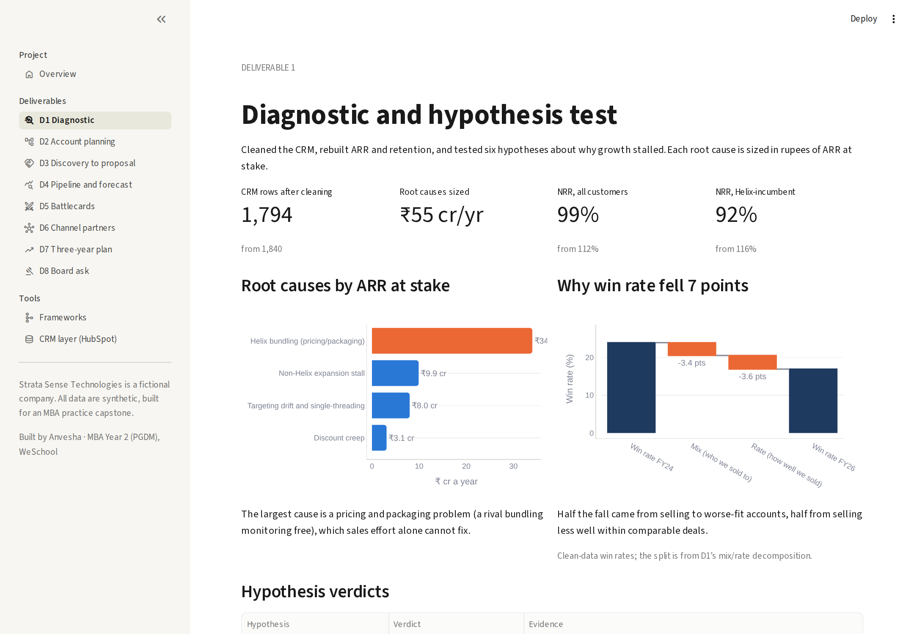 | 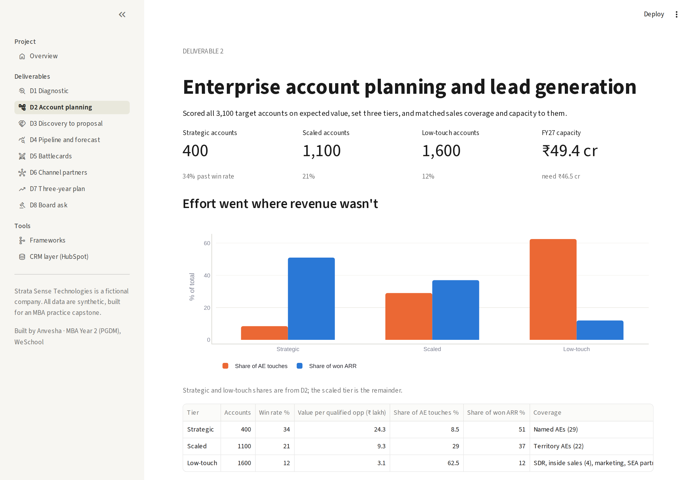 |
| D1 — root causes and the win-rate split | D2 — effort vs revenue by account tier |
| 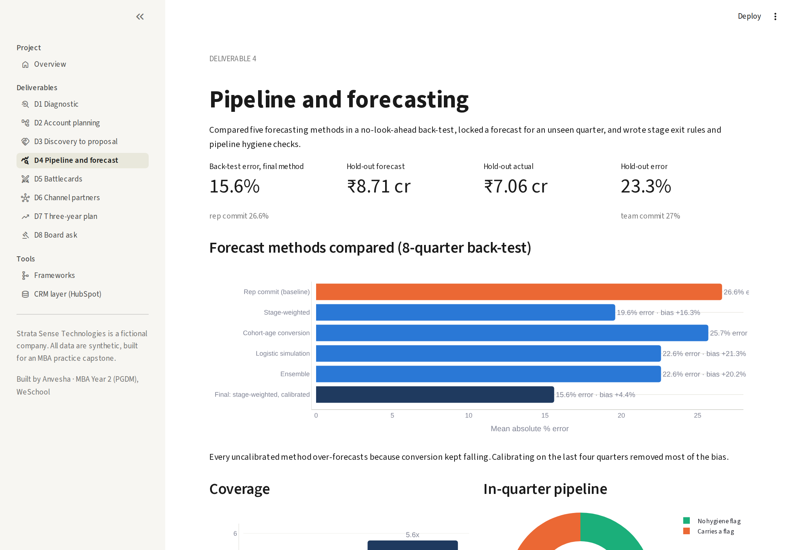 | 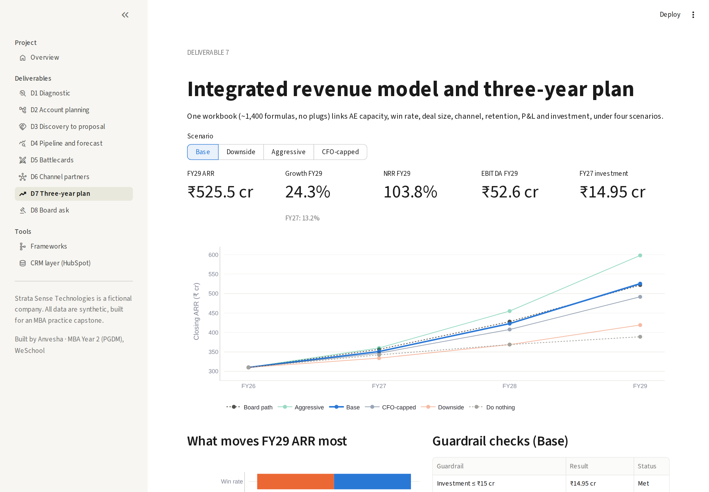 |
| D4 — forecast methods back-tested | D7 — scenario switch and ARR paths |
| 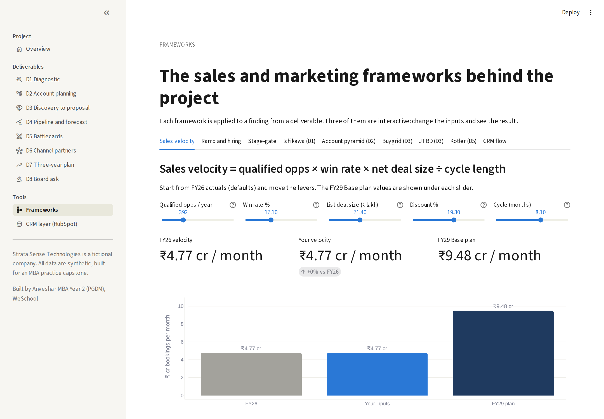 | 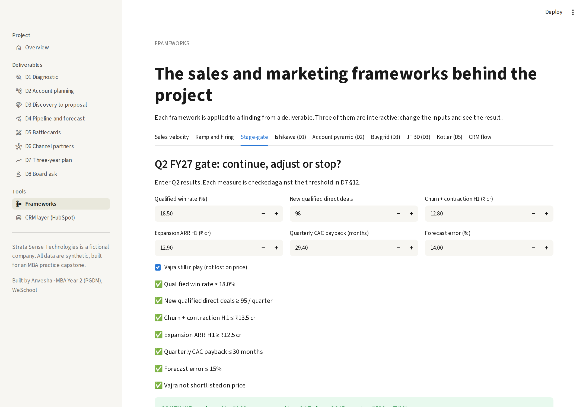 |
| Interactive sales velocity calculator | Interactive Q2 stage-gate check |

Run it locally:

```bash
cd dashboard
pip install -r requirements.txt
streamlit run streamlit_app.py
```

## The CRM layer, built in HubSpot

The plan's "load the CRM" step was built, not left as a slide. The cleaned D1 accounts and the D4 open-pipeline snapshot were loaded into a free HubSpot CRM: 1,995 Company records and 279 Deal records on a 5-stage pipeline named exactly as in D4. D4's stage exit rules became computed deal properties (five hygiene flags, a flag count and a Clean/Flagged status), and each flag was checked against D4's published count before it was written: all five matched, flagging 105 of 279 open deals (₹49.5 cr). Four guardrail properties were added (CAC, CAC payback, Gross margin %, Discount %); Discount % is filled on the 128 quoted deals, 121 of which are above the 14% guardrail.

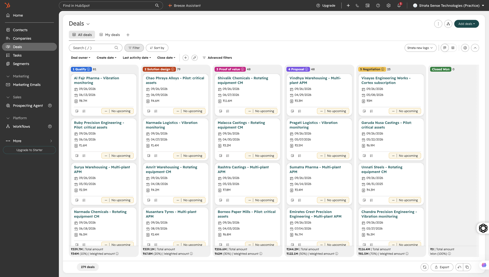

| | |
|---|---|
| 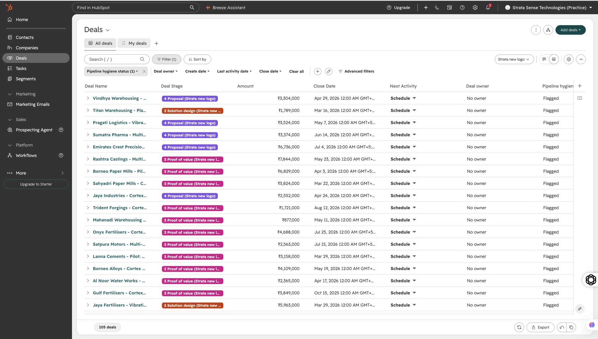 | 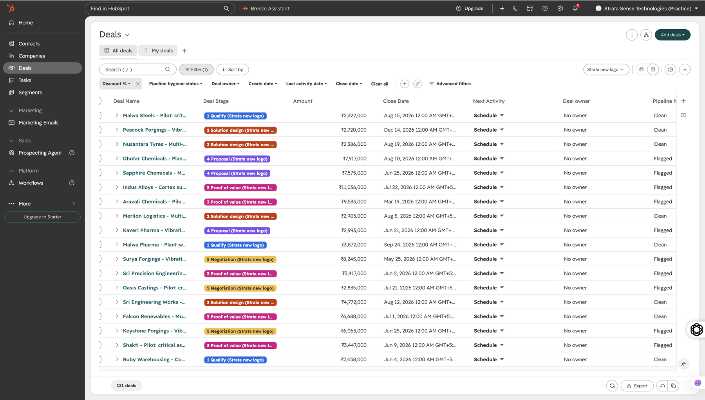 |
| Flagged deals: 105 | Discount above the 14% guardrail: 121 |
| 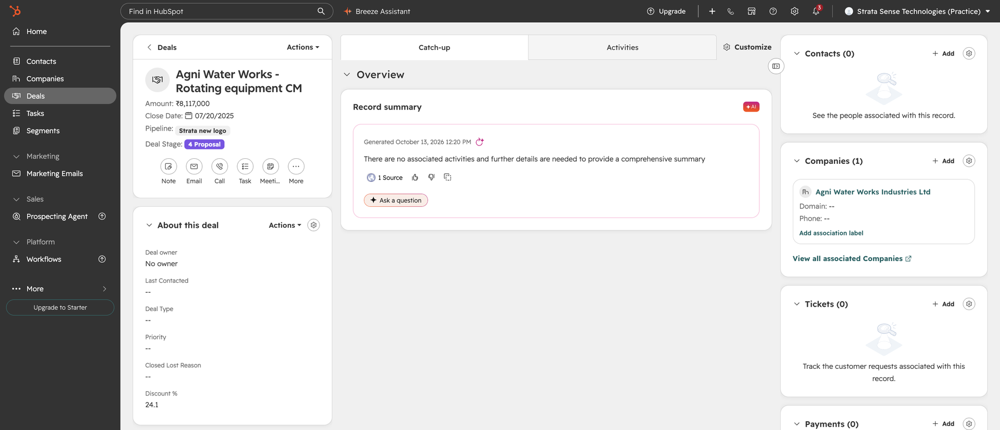 | 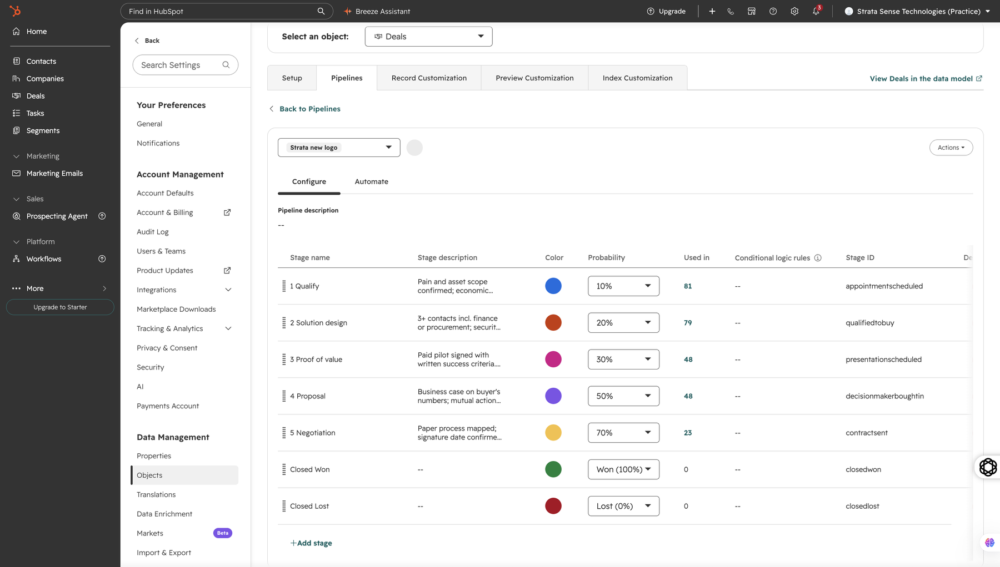 |
| One flagged deal record | Five stages, each with D4's exit rule |

## Full report

`Strata_Sense_Final_Project_Report.docx` / `.pdf` (26 pages) covers the assignment, method, all 8 deliverables, the frameworks, the 4 mid-project injects, primary evidence and benchmarks, limitations, both HubSpot workflows and the dashboard. Not included in this repo; available on request.

## Tools

Python (pandas, numpy, statsmodels) for data cleaning and modelling; Excel workbooks with live formulas, recalculated and error-checked; Word memos and PowerPoint decks generated from code so every figure traces to the analysis; HubSpot (free CRM) for the implementation; Streamlit and Plotly for the dashboard.

## AI use

This project was built with an AI assistant (Claude): drafting, analysis code, the CRM build and the dashboard were AI-assisted throughout, working from a synthetic data room built for the assignment. Every figure is reproducible from the code in each deliverable's `code/` folder.

—

Anvesha · MBA Year 2 (PGDM), Prin. L.N. Welingkar Institute of Management Development and Research (WeSchool)
